 

  

###

<h3 data-importer="text" align="left">Hi 👋! My name is Sabrina and I'm a passionate web developer 👾, from Algeria.</h3>

###

  
  
  
  
  
  
  
  
  
  
  
  
  
  
  
  
  
  
  
  
  
  
  
  
  
  
  
  
  
  
  
  
  
  
  
  
  

###

  

###

 

###

 

  

###
